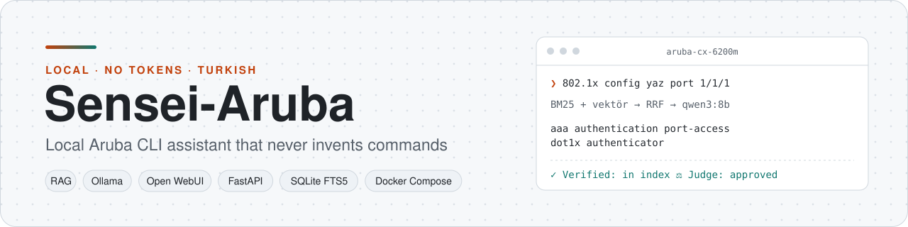
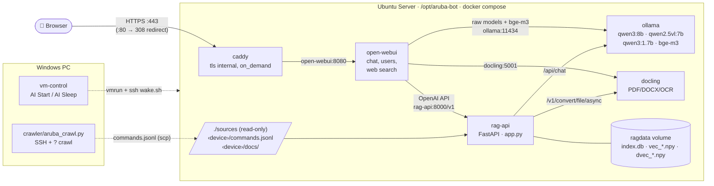
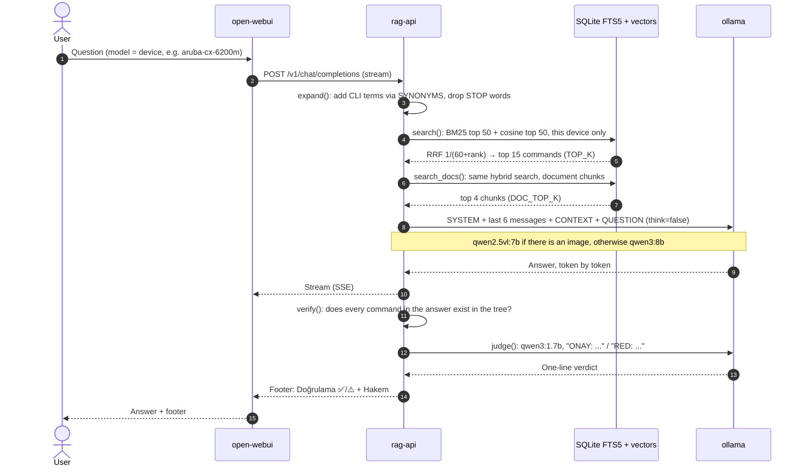
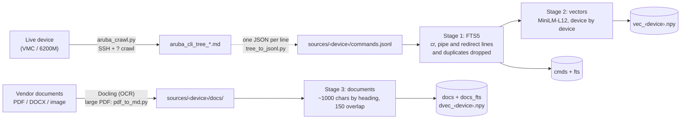
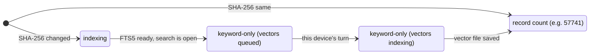

<div align="center">

<picture>
  <source media="(prefers-color-scheme: dark)" srcset="docs/assets/banner-dark.svg">
  
</picture>

<br/>

**An assistant that explains network-device CLI commands using only the real command index crawled from the device and the vendor documentation. It runs on your own server with no API and no tokens.**

[English](README.md) · [Türkçe](README.tr.md)


-2ea44f)

[Why?](#-problem-and-solution) · [Architecture](#-architecture) · [Quick start](#-quick-start) · [Usage](#-usage) · [API](#-api-reference) · [Configuration](#-configuration) · [Guide](docs/USAGE.md)

</div>

---

## ✨ At a glance

- 🔎 **Hybrid search:** 160k commands (Aruba VMC 57,741 + CX 6200M 102,032, after filtering) and 7,333 document chunks, searched with SQLite FTS5 (BM25) plus multilingual vector search, merged with Reciprocal Rank Fusion.
- ✅ **Two layers against hallucination:** every `command` in an answer is looked up in the device's real command tree, and a small judge model returns `ONAY` (approve) or `RED` (reject) depending on whether the context supports the answer.
- 🧱 **Devices never mix:** each device is its own model in Open WebUI (`aruba-vmc`, `aruba-cx-6200m`); search only covers that device's index and documents.
- 🖼️ **Image reading:** if a message contains an image (CLI output, error screen), the request is routed to `qwen2.5vl:7b` automatically.
- 🏠 **Fully local:** models run on CPU in Ollama; only Caddy's ports 80/443 are exposed.
- 🔁 **Self-updating:** drop a new `commands.jsonl` or document under `sources/<device>/` and only the changed files are re-indexed within 15 minutes (SHA-256).

> **Language:** the documentation is in English (Turkish versions live in [`docs/tr/`](docs/tr/) and [`README.tr.md`](README.tr.md)). The assistant itself currently answers in Turkish: its prompt and the `Doğrulama` / `Hakem` footer are Turkish (see `server/rag-api/app.py`).

---

## 📑 Contents

- [Problem and solution](#-problem-and-solution)
- [Architecture](#-architecture)
- [Tech stack](#-tech-stack)
- [Quick start](#-quick-start)
- [Usage](#-usage)
- [API reference](#-api-reference)
- [Configuration](#-configuration)
- [Project structure](#-project-structure)
- [Development and testing](#-development-and-testing)
- [Security and limits](#-security-and-limits)
- [Roadmap](#-roadmap)
- [Contributing and license](#-contributing-and-license)

---

## 🎯 Problem and solution

| Problem | Solution in Sensei-Aruba |
|---|---|
| General-purpose LLMs **invent** CLI commands (nonexistent parameters, wrong mode). | The model answers only from the retrieved `BAĞLAM` (context); commands in the answer are verified deterministically against the command tree. |
| Command indexes are huge (233k lines); generic document RAG is slow and inaccurate. | A separate `rag-api` service: FTS5 for exact keyword matches, vectors for meaning, merged with RRF. |
| Cloud APIs need tokens and send configuration data outside. | Open-weight Qwen models run in Ollama on your own server; no API key. |
| Commands of different devices get mixed up. | Folder name = model name; each model searches only its own device's index. |
| Retraining for every new document is expensive. | No fine-tuning, just RAG: put the file in the folder. |

**Design decisions and their reasons** (details: [USAGE.md §1](docs/USAGE.md#1-overview)):

| Decision | Reason |
|---|---|
| **RAG** instead of fine-tuning | Commands come verbatim from the index; no training for new documents. |
| **Open models** instead of Claude/GPT | Requirement: local and token-free operation. |
| **Docker Compose**, brand-agnostic design | Start/stop with one command; new device = new `sources/<device>/` folder. |
| **Separate `rag-api`** service | Open WebUI's generic RAG was too slow and inaccurate for a 233k-line CLI index. |
| **Two-stage indexing** | The keyword index is ready in minutes; vectors are computed device by device in the background. |

---

## 🧩 Architecture

### Components



| Layer | Component | Responsibility |
|---|---|---|
| Entry | `caddy` | TLS termination (own CA), HTTP→HTTPS, the only exposed ports |
| Presentation | `open-webui` | Chat UI, user management, image upload, web search |
| Orchestration | `rag-api` (`server/rag-api/app.py`) | Indexing, hybrid search, prompt building, verification, judge; OpenAI-compatible API |
| Data | SQLite FTS5 + NumPy (`ragdata` volume) | Command and document tables, normalized vector matrices |
| Inference | `ollama` | Answer, vision and judge models (CPU) |
| Conversion | `docling` | PDF/Office/image → Markdown (OCR on) |
| Collection | `crawler/` (PC) | Crawls the CLI tree from a live device using `?` help |
| Operations | systemd units, `vm-control/` | Boot, re-index every 15 min, drop idle cache, suspend/resume the VM |

### The path of a question



### Indexing



Indexing runs when rag-api starts and every 15 minutes via `aruba-bot-ingest.timer`. A device is not reprocessed if the SHA-256 of its `commands.jsonl` is unchanged. A device's state in `/health` moves through these steps:



> More (data model ER diagram, wake/repair flow, memory management): **[docs/architecture.md](docs/architecture.md)**

---

## 🧰 Tech stack

Versions were read from the running installation on 2026-11-01. Compose images are tagged `latest`/`main`, so a fresh install may differ.

| Component | Technology | Version | Role |
|---|---|---|---|
| LLM server | [Ollama](https://ollama.com) | 0.40.6 | Runs the models on CPU |
| Answer model | `qwen3:8b` | — | Turkish answers, instruction following |
| Vision model | `qwen2.5vl:7b` | — | Reading screenshots / CLI output |
| Judge model | `qwen3:1.7b` | — | One-line `ONAY` / `RED` |
| UI | [Open WebUI](https://github.com/open-webui/open-webui) | 0.12.3 | Chat, users, web search (DuckDuckGo) |
| RAG service | Python + FastAPI + uvicorn | 3.12.16 / 0.162.0 | `rag-api` |
| Vectors | fastembed (ONNX) · `paraphrase-multilingual-MiniLM-L12-v2` | 0.9.1 | 384-dim multilingual embeddings |
| Keyword | SQLite FTS5 (BM25) | — | Exact command matching |
| Document conversion | Docling Serve (CPU) | `latest` | PDF/Office/image → Markdown, OCR |
| Reverse proxy | Caddy | 2.11.7 | HTTPS, `tls internal` |
| Container runtime | Docker Engine + Compose plugin | 29.1.3 (Engine) | All services |
| Operating system | Ubuntu Server | 26.04.1 LTS | VMware Workstation VM |
| Crawler | Python + paramiko | — | Extracts the CLI tree from a device |

---

## 🚀 Quick start

**Prerequisites:** an Ubuntu Server with Docker and the Compose plugin, and disk space (models ~14 GB, OS + images ~20 GB; 150 GB recommended). The current setup runs on 12 vCPU / 14 GB RAM with no GPU; sizing advice: [USAGE.md §3](docs/USAGE.md#3-hardware-and-virtual-machine).

```bash
# 1) Get the code and prepare the server folder
git clone https://github.com/emreyigit-tasdelen/Sensei-Aruba.git && cd Sensei-Aruba
sudo mkdir -p /opt/aruba-bot && sudo chown $USER /opt/aruba-bot
cp -r server/. /opt/aruba-bot/

# 2) Put the command index in place as a source (folder name = model name).
#    The sample in the repo is enough for a quick try; generate the full index from
#    your own device (crawler/README.md: crawl + tree_to_jsonl.py).
for d in aruba-vmc aruba-cx-6200m; do
  mkdir -p /opt/aruba-bot/sources/$d && cp crawler/$d/commands.sample.jsonl /opt/aruba-bot/sources/$d/commands.jsonl
done

# 3) Start the services and pull the models
cd /opt/aruba-bot && sudo docker compose up -d --build
for m in qwen3:8b qwen3:1.7b qwen2.5vl:7b bge-m3; do sudo docker compose exec ollama ollama pull $m; done

# 4) Check the index status
sh status.sh
```

Expected output (once indexing has finished):

```json
{"status":"ready","devices":{"aruba-cx-6200m":102032,"aruba-vmc":57741},"docs":{"aruba-cx-6200m":{"files":0,"chunks":0},"aruba-vmc":{"files":5,"chunks":7333}}}
```

> ⏱️ **Timing:** the containers come up in a few minutes and keyword search works immediately (`keyword-only`). Downloading the models (~14 GB) and vector indexing on CPU (6200M ~1.5 h, VMC ~1 h) take longer. Until then, answers start with a "vector index is being prepared" note.

Then open `https://<server-ip>` in a browser. The certificate is self-signed, so the browser warns. **The first user to register becomes admin.** For a permanent setup (systemd units, firewall, Open WebUI settings): [USAGE.md §7–§13](docs/USAGE.md#7-application-files).

---

## 💬 Usage

Pick the device from the model menu on the chat screen (`aruba-vmc` or `aruba-cx-6200m`) and write your question in Turkish:

- `802.1x config yaz bana port ge 1 1 1 için` (write me an 802.1x config for port ge 1/1/1)
- `show komutlarıyla aaa ayarlarını nasıl görürüm?` (how do I see the AAA settings with show commands?)
- `vlan 10 oluşturup 1/1/5 portuna access olarak ata` (create VLAN 10 and assign it to port 1/1/5 as access)

You can also ask from the server's command line (`server/ask.sh`):

```bash
sh /opt/aruba-bot/ask.sh aruba-cx-6200m "802.1x config yaz bana port 1/1/1 için"
```

<details open>
<summary><b>Real output</b> (2026-11-01, unedited; this run took 9 min 37 s on CPU, including model loading and the judge)</summary>

````text
```plaintext
aaa authentication port-access dot1x authenticator interface 1/1/1
```

**Komut Açıklaması:**
Bu komut, cihazın belirli bir port üzerinde (1/1/1) 802.1X kimlik doğrulama özelliğini etkinleştirir. Bu işlem, `config` modunda çalışır.
...
Kaynak: [aruba-cx-6200m | config] aaa authentication port-access dot1x authenticator interface — Configure the switch as an 802.1X authenticator.

---
**Doğrulama:** ✅ 0 komut dizinde var · ⚠️ dizinde yok: `aaa authentication port-access dot1x authenticator interface 1/1/1`
**Hakem:** ONAY: Komutlar BAĞLAM ile destekleniyor.
````

This example shows why both layers are used together. The judge model approved the answer. The deterministic verification, however, caught that the model appended `1/1/1` to a command from the index and that the resulting line is not in the command tree. The user sees the ⚠️ mark and checks the command on the device with `?`.

</details>

What the footer at the end of an answer means:

| Line | Meaning |
|---|---|
| `Doğrulama: ✅ N komut dizinde var` (verification: N commands exist in the index) | The commands in the answer were found in the device's command tree (`<PARAM>`, `A.B.C.D` and UPPERCASE placeholders are allowed). |
| `⚠️ dizinde yok: ...` (not in the index) | The command is not in the tree. It may also come from a submode the crawler did not visit; check it on the device with `?`. |
| `Hakem: ONAY / RED` (judge: approve / reject) | `qwen3:1.7b` decided whether the context supports the answer. |

**Adding a new device:** put `sources/<device-name>/commands.jsonl` in place (lowercase folder name with hyphens, e.g. `aruba-cx-6300`) and the documents under `sources/<device-name>/docs/`. Details: [USAGE.md §15–§16](docs/USAGE.md#15-adding-a-new-device-or-brand).

---

## 🔌 API reference

`rag-api` is reachable only on the Docker internal network (`http://rag-api:8000`); no port is published.

| Endpoint | Description |
|---|---|
| `GET /v1/models` | Device list = model list (Open WebUI reads this) |
| `POST /v1/chat/completions` | OpenAI-compatible chat, supports `stream: true` |
| `GET /health` | Overall status and device/document index status |
| `POST /ingest` | Starts re-indexing; if indexing is already running it returns `{"started": false, "reason": "indexing"}` |

<details>
<summary><b>Example requests and responses</b></summary>

On the server, from inside the container:

```bash
cd /opt/aruba-bot
sudo docker compose exec -T rag-api python -c "import urllib.request;print(urllib.request.urlopen('http://localhost:8000/v1/models').read().decode())"
```

```json
{"object": "list", "data": [{"id": "aruba-cx-6200m", "object": "model", "owned_by": "rag-api"},
                            {"id": "aruba-vmc", "object": "model", "owned_by": "rag-api"}]}
```

Chat request body (OpenAI format; for an image, add an `image_url` part with a `data:` URL (base64) to the `content` array):

```json
{"model": "aruba-vmc", "stream": false,
 "messages": [{"role": "user", "content": "show ap database komutu ne gösterir?"}]}
```

Response: `choices[0].message.content` = the model's answer, then a `---` separator followed by the `Doğrulama` and `Hakem` lines.

</details>

---

## 🔧 Configuration

All settings are in [`server/compose.yaml`](server/compose.yaml). Because Open WebUI runs with `ENABLE_PERSISTENT_CONFIG: "false"`, this file wins on every start over changes made in the UI.

<details>
<summary><b>rag-api environment variables</b></summary>

| Variable | Default (code) | Value in Compose | Description |
|---|---|---|---|
| `OLLAMA_URL` | `http://ollama:11434` | same | Ollama address |
| `CHAT_MODEL` | `qwen3:8b` | `qwen3:8b` | Answer model |
| `VISION_MODEL` | `qwen2.5vl:7b` | `qwen2.5vl:7b` | Messages that contain an image |
| `JUDGE_MODEL` | `""` (off) | `qwen3:1.7b` | If empty the judge LLM is skipped and the deterministic verification continues |
| `EMB_MODEL` | `sentence-transformers/paraphrase-multilingual-MiniLM-L12-v2` | — | If you change it, delete the index and rebuild |
| `TOP_K` | `15` | — | Number of commands in the context |
| `DOC_TOP_K` | `4` | — | Number of document chunks in the context |
| `DOCLING_URL` | `http://docling:5001` | — | Document converter |
| `DATA_DIR` | `/data` | `ragdata` volume | SQLite and vector files |
| `SOURCES_DIR` | `/sources` | `./sources` (read-only) | Device folders |

</details>

<details>
<summary><b>Ollama and resource limits</b></summary>

| Setting | Value | Reason |
|---|---|---|
| `OLLAMA_MAX_LOADED_MODELS` | `3` | Answer/vision + judge + embedding in memory at once |
| `OLLAMA_NUM_PARALLEL` | `1` | A single request is the most efficient on CPU |
| `OLLAMA_KEEP_ALIVE` | `5m` | A model idle for 5 min is evicted from memory |
| `OLLAMA_CONTEXT_LENGTH` | `8192` | Enough for context + history |
| `cpus` (ollama / docling / rag-api) | `10` / `4` / `4` | So SSH and the UI do not freeze |
| `mem_limit` (ollama) | `10g` | Prevents overflow on a 14 GB VM |
| Log | `10m × 3` | Disk protection |

</details>

<details>
<summary><b>Open WebUI</b></summary>

| Variable | Value | Description |
|---|---|---|
| `WEBUI_NAME` | `Sensei-Aruba` | UI name ([`open-webui/Dockerfile`](server/open-webui/Dockerfile) removes the name suffix) |
| `DEFAULT_MODELS` | `aruba-vmc` | Default device |
| `OPENAI_API_BASE_URL` | `http://rag-api:8000/v1` | Device models come from here |
| `ENABLE_*_GENERATION` | `false` | Title/tag/suggestion generation off (slow on CPU) |
| `RAG_EMBEDDING_MODEL` | `bge-m3` | For Open WebUI's own Knowledge RAG |
| `CONTENT_EXTRACTION_ENGINE` | `docling` | Uploaded files are processed with Docling |
| `WEB_SEARCH_ENGINE` | `duckduckgo` | Enabled per chat |

</details>

<details>
<summary><b>Server scripts and systemd units</b></summary>

| File | Purpose |
|---|---|
| `ask.sh <model> "<question>"` | Asks rag-api a question from the command line |
| `status.sh` | `/health` output + errors in the rag-api logs |
| `bench.sh` | Measures `qwen3:8b` load time and tokens/s |
| `wake.sh` | Repair ladder after boot/resume until HTTPS returns 200 |
| `idle.sh [status]` | Is it idle (`idle`/`active`)? If idle, drops the page cache |
| `netdiag.sh` | Network diagnostics for the Caddy ports |
| `docling-api.sh` | Lists the Docling API paths (diagnostics) |
| `aruba-bot.service` | `docker compose up -d` at boot |
| `aruba-bot-ingest.timer` | `POST /ingest` every 15 min |
| `aruba-bot-idle.timer` | `idle.sh` every 5 min |

</details>

---

## 📂 Project structure

```text
Sensei-Aruba/
├── server/                          # Everything copied to /opt/aruba-bot on the server
│   ├── compose.yaml                 # 5 services: ollama, docling, rag-api, open-webui, caddy
│   ├── Caddyfile                    # HTTPS, tls internal + on_demand, proxy to open-webui:8080
│   ├── rag-api/
│   │   ├── app.py                   # Indexing, hybrid search, verification, judge, OpenAI API
│   │   └── Dockerfile               # python:3.12-slim + fastapi, uvicorn, httpx, numpy, fastembed
│   ├── open-webui/Dockerfile        # Stock image with only the " (Open WebUI)" name suffix removed
│   ├── tools/pdf_to_md.py           # Converts thousand-page PDFs to Markdown with headings from bookmarks
│   ├── aruba-bot*.service / .timer  # systemd: boot, re-indexing, dropping idle cache
│   └── *.sh                         # ask, status, bench, wake, idle, netdiag, docling-api
├── crawler/
│   ├── tree_to_jsonl.py             # Converts tree .md files to the commands.jsonl rag-api reads
│   ├── aruba-vmc/                   # AOS 8 Mobility Controller crawl
│   │   ├── aruba_crawl.py           # SSH + ? DFS crawler, resumes where it stopped
│   │   ├── run_crawl.ps1            # Asks for the password once, retries after 30 s if it crashes
│   │   └── commands.sample.jsonl    # 300-line sample; generate the full index from your own device
│   └── aruba-cx-6200m/              # CX 6200M switch, same layout
├── vm-control/                      # Windows: start/suspend the VMware VM, desktop shortcuts
└── docs/
    ├── USAGE.md                     # Install from scratch, all settings and reasons, troubleshooting
    ├── architecture.md              # Components, data model, sequence and state diagrams
    ├── troubleshooting.md           # Problems met during setup, root causes, fixes
    ├── tr/                          # Turkish versions of the documents
    └── assets/                      # Banners
```

---

## 🧪 Development and testing

The repo has **no** automated tests, lint or CI. Quality is checked at runtime by two layers: deterministic command verification (`verify()`) and the judge model (`judge()`). Their results are visible under every answer.

Manual checks after a change:

```bash
python -m py_compile server/rag-api/app.py          # syntax
cd /opt/aruba-bot && sudo docker compose config -q   # is the compose file valid
sudo docker compose up -d --build rag-api            # rebuild rag-api
sh status.sh && sh bench.sh                          # index status and model speed
sh ask.sh aruba-vmc "show ap database ne gösterir?"  # end-to-end smoke test
```

> ⚠️ If rag-api restarts, **partial vector indexing starts over** (finished devices are kept). Apply code changes after indexing has finished.

**Working rule:** do not edit files on the server by hand. Change them in the repo, copy them to the server, then commit and push. ([Why?](docs/troubleshooting.md))

---

## 🔒 Security and limits

**Security**
- Only Caddy (80/443) is published. Ollama 11434, rag-api 8000, Docling 5001 and Open WebUI 8080 stay on the Docker internal network.
- The crawler asks for the device password once per run and never writes it to disk. Password and key files are in `.gitignore`.
- When web search is enabled, queries go to DuckDuckGo; do not enable it for sensitive information.
- In Open WebUI set new sign-ups to "pending" and hide the raw models from users. Details: [USAGE.md §21](docs/USAGE.md#21-security-hardening).

**Known limits**
- Slow on CPU: ~3 tokens/s with `qwen3:8b`. An answer usually takes 1–3 minutes, longer when model loading and the judge are added (the example above took 9.5 min).
- Commands in submodes the crawler did not visit are not in the index; verification may show ⚠️ for them.
- The certificate is self-signed, so the browser warns.
- The meaning of diagrams inside documents is not interpreted; only the text inside them is read with OCR.
- The UI is unreachable while the VM is suspended. Waking takes ~30 s to 3 min.
- The Open WebUI build without the name suffix is licensed only for **≤50 users in 30 days**. If you exceed that, go back to the stock image.

---

## 🧭 Roadmap

Source: [USAGE.md §22](docs/USAGE.md#22-limits-and-next-steps)

- [x] Per-device PDF/document search
- [ ] Regular measurement with a 30–50 question quality test set
- [ ] GPU server (16 GB+ VRAM): about 10× faster with `qwen3:14b`, the architecture carries over unchanged
- [ ] Crawlers for other brands
- [ ] Documents specific to the 6200M
- [ ] Add approved correct answers to the index as "approved Q&A"

---

## 🤝 Contributing and license

You can open an issue or send a PR with suggestions. Code style: follow the layout of the existing files. Server-side Linux files must use LF and PowerShell files CRLF (`.gitattributes` enforces this).

**Not in the repo**
- Passwords and SSH keys (`.gitignore`)
- Vendor PDFs and the Markdown generated from them (copyright; source list in [USAGE.md §16.1.2](docs/USAGE.md#1612-installed-documents-2026-10-31))
- Docker volumes (models, indexes, users): they are regenerated on the server

**License:** [Apache-2.0](LICENSE), see [NOTICE](NOTICE). Aruba and HPE are trademarks of their respective owners; this project is independent. The components used keep their own licenses (Open WebUI, Ollama, Docling, Qwen models).

## Support

- GitHub Sponsors: https://github.com/sponsors/emreyigit-tasdelen
- Buy Me a Coffee: https://buymeacoffee.com/emreyigit.tasdelen
