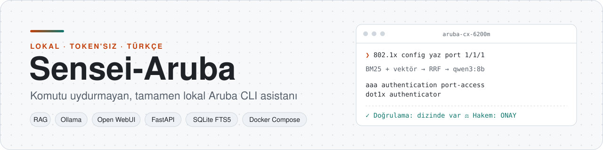
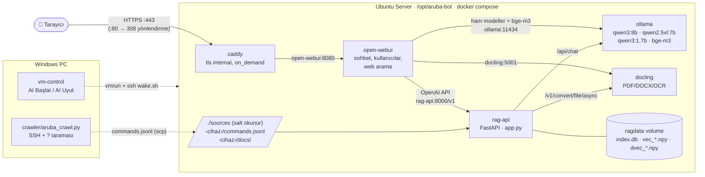
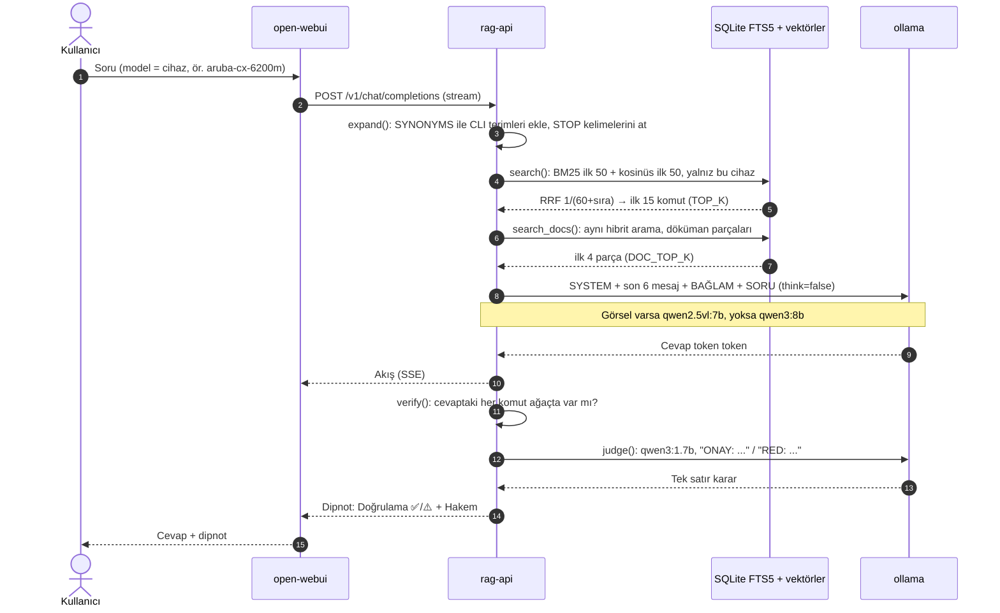
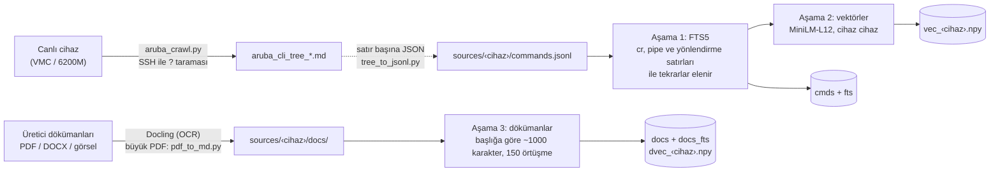
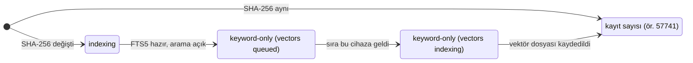

<div align="center">

<picture>
  <source media="(prefers-color-scheme: dark)" srcset="docs/assets/banner-dark.tr.svg">
  
</picture>

<br/>

**Ağ cihazlarının CLI komutlarını, yalnızca cihazdan taranmış gerçek komut dizinine ve üretici dökümanlarına dayanarak Türkçe anlatan, API/token kullanmadan kendi sunucunuzda çalışan asistan.**

[English](README.md) · [Türkçe](README.tr.md)


-2ea44f)

[Neden?](#-problem-ve-çözüm) · [Mimari](#-mimari) · [Hızlı başlangıç](#-hızlı-başlangıç) · [Kullanım](#-kullanım) · [API](#-api-referansı) · [Yapılandırma](#-yapılandırma) · [Kılavuz](docs/tr/KULLANIM.md)

</div>

---

## ✨ Bir bakışta

- 🔎 **Hibrit arama:** 160 bin komut (Aruba VMC 57.741 + CX 6200M 102.032, filtre sonrası) ve 7.333 döküman parçası üzerinde SQLite FTS5 (BM25) + çok dilli vektör araması, Reciprocal Rank Fusion ile birleştirilir.
- ✅ **Uydurmaya karşı iki katman:** cevaptaki her `komut` cihazın gerçek komut ağacında aranır; ayrıca küçük bir hakem model cevabın bağlamla desteklenip desteklenmediğine `ONAY` / `RED` verir.
- 🧱 **Cihazlar asla karışmaz:** her cihaz Open WebUI'da ayrı bir model (`aruba-vmc`, `aruba-cx-6200m`); arama yalnız o cihazın dizininde ve dökümanlarında yapılır.
- 🖼️ **Görsel okuma:** mesajda görsel varsa (CLI çıktısı, hata ekranı) istek otomatik olarak `qwen2.5vl:7b` modeline gider.
- 🏠 **Tamamen lokal:** modeller Ollama'da CPU üzerinde çalışır; dışarıya yalnızca Caddy'nin 80/443 portları açıktır.
- 🔁 **Kendini günceller:** `sources/<cihaz>/` altına yeni `commands.jsonl` veya döküman koyunca 15 dakika içinde yalnız değişen dosyalar yeniden indekslenir (SHA-256).


---

## 📑 İçindekiler

- [Problem ve çözüm](#-problem-ve-çözüm)
- [Mimari](#-mimari)
- [Teknoloji yığını](#-teknoloji-yığını)
- [Hızlı başlangıç](#-hızlı-başlangıç)
- [Kullanım](#-kullanım)
- [API referansı](#-api-referansı)
- [Yapılandırma](#-yapılandırma)
- [Proje yapısı](#-proje-yapısı)
- [Geliştirme ve test](#-geliştirme-ve-test)
- [Güvenlik ve sınırlar](#-güvenlik-ve-sınırlar)
- [Yol haritası](#-yol-haritası)
- [Katkı ve lisans](#-katkı-ve-lisans)

---

## 🎯 Problem ve çözüm

| Problem | Sensei-Aruba'daki çözüm |
|---|---|
| Genel amaçlı LLM'ler CLI komutlarını **uydurur** (olmayan parametre, yanlış mod). | Model yalnız aramadan gelen `BAĞLAM` ile cevap verir; cevaptaki komutlar komut ağacıyla deterministik olarak doğrulanır. |
| Komut dizinleri dev boyutta (233 bin satır); genel döküman RAG'ı yavaş ve isabetsiz. | Ayrı `rag-api` servisi: birebir kelime eşleşmesi için FTS5, anlam için vektör, ikisi RRF ile birleşir. |
| Bulut API'leri token ister ve konfigürasyon bilgisini dışarı taşır. | Açık ağırlıklı Qwen modelleri Ollama'da, kendi sunucunuzda; API anahtarı yok. |
| Farklı cihazların komutları birbirine karışır. | Klasör adı = model adı; her model yalnız kendi cihazının dizininde arar. |
| Her yeni döküman için yeniden eğitim pahalı. | Fine-tuning yok, RAG var: dosyayı klasöre koymak yeterli. |

**Tasarım kararları ve nedenleri** (ayrıntı: [KULLANIM.md §1](docs/tr/KULLANIM.md#1-genel-bakış)):

| Karar | Neden |
|---|---|
| Fine-tuning yerine **RAG** | Komutlar dizinden birebir gelir, yeni döküman için eğitim gerekmez. |
| Claude/GPT yerine **açık modeller** | Lokal ve token'sız çalışma şartı. |
| **Docker Compose**, markadan bağımsız tasarım | Tek komutla aç/kapa; yeni cihaz = yeni `sources/<cihaz>/` klasörü. |
| **Ayrı `rag-api`** servisi | Open WebUI'ın genel RAG'ı 233 bin satırlık CLI dizini için yavaş ve isabetsizdi. |
| **İki aşamalı indeksleme** | Anahtar kelime indeksi dakikalar içinde hazır olur; vektörler arkadan cihaz cihaz hesaplanır. |

---

## 🧩 Mimari

### Bileşenler



| Katman | Bileşen | Sorumluluk |
|---|---|---|
| Giriş | `caddy` | TLS sonlandırma (kendi CA'sı), HTTP→HTTPS, tek açık port grubu |
| Sunum | `open-webui` | Sohbet arayüzü, kullanıcı yönetimi, görsel yükleme, web arama |
| Orkestrasyon | `rag-api` (`server/rag-api/app.py`) | İndeksleme, hibrit arama, istem kurma, doğrulama, hakem; OpenAI uyumlu API |
| Veri | SQLite FTS5 + NumPy (`ragdata` volume) | Komut ve döküman tabloları, normalize vektör matrisleri |
| Çıkarım | `ollama` | Cevap, görsel ve hakem modelleri (CPU) |
| Dönüştürme | `docling` | PDF/Office/görsel → Markdown (OCR açık) |
| Toplama | `crawler/` (PC) | Canlı cihazdan `?` yardımıyla CLI ağacını tarar |
| Operasyon | systemd birimleri, `vm-control/` | Açılış, 15 dk'da bir yeniden indeksleme, boşta önbellek bırakma, VM uyut/uyandır |

### Bir sorunun yolu



### İndeksleme



İndeksleme rag-api açılırken ve `aruba-bot-ingest.timer` ile 15 dakikada bir çalışır. `commands.jsonl` dosyasının SHA-256 özeti değişmediyse cihaz yeniden işlenmez. Bir cihazın durumu `/health` çıktısında şu sırayla ilerler:



> Daha fazlası (veri modeli ER diyagramı, uyanma/onarım akışı, bellek yönetimi): **[docs/tr/architecture.md](docs/tr/architecture.md)**

---

## 🧰 Teknoloji yığını

Sürümler, çalışan kurulumdan 2026-11-01'de okundu. Compose imajları `latest`/`main` etiketli olduğundan yeni kurulumda değişebilir.

| Bileşen | Teknoloji | Sürüm | Rolü |
|---|---|---|---|
| LLM sunucusu | [Ollama](https://ollama.com) | 0.40.6 | Modelleri CPU'da çalıştırır |
| Cevap modeli | `qwen3:8b` | — | Türkçe cevap, talimata uyum |
| Görsel modeli | `qwen2.5vl:7b` | — | Ekran görüntüsü / CLI çıktısı okuma |
| Hakem modeli | `qwen3:1.7b` | — | Tek satır `ONAY` / `RED` |
| Arayüz | [Open WebUI](https://github.com/open-webui/open-webui) | 0.12.3 | Sohbet, kullanıcılar, web arama (DuckDuckGo) |
| RAG servisi | Python + FastAPI + uvicorn | 3.12.16 / 0.162.0 | `rag-api` |
| Vektör | fastembed (ONNX) · `paraphrase-multilingual-MiniLM-L12-v2` | 0.9.1 | 384 boyutlu çok dilli embedding |
| Anahtar kelime | SQLite FTS5 (BM25) | — | Birebir komut eşleşmesi |
| Döküman dönüştürme | Docling Serve (CPU) | `latest` | PDF/Office/görsel → Markdown, OCR |
| Reverse proxy | Caddy | 2.11.7 | HTTPS, `tls internal` |
| Konteyner | Docker Engine + Compose eklentisi | 29.1.3 (Engine) | Tüm servisler |
| İşletim sistemi | Ubuntu Server | 26.04.1 LTS | VMware Workstation VM'i |
| Tarayıcı (crawler) | Python + paramiko | — | Cihazdan CLI ağacını çıkarır |

---

## 🚀 Hızlı başlangıç

**Önkoşullar:** Docker ve Compose eklentisi kurulu bir Ubuntu Server, disk (modeller ~14 GB, işletim sistemi + imajlar ~20 GB; 150 GB önerilir). Mevcut kurulum 12 vCPU / 14 GB RAM ile GPU'suz çalışıyor; boyutlandırma önerileri: [KULLANIM.md §3](docs/tr/KULLANIM.md#3-donanım-ve-sanal-makine).

```bash
# 1) Kodu al ve sunucu klasörünü hazırla
git clone https://github.com/emreyigit-tasdelen/Sensei-Aruba.git && cd Sensei-Aruba
sudo mkdir -p /opt/aruba-bot && sudo chown $USER /opt/aruba-bot
cp -r server/. /opt/aruba-bot/

# 2) Komut dizinini kaynak olarak koy (klasör adı = model adı).
#    Hızlı deneme için repodaki örnek yeter; tam dizini kendi cihazınızdan üretin
#    (crawler/README.md: tarama + tree_to_jsonl.py).
for d in aruba-vmc aruba-cx-6200m; do
  mkdir -p /opt/aruba-bot/sources/$d && cp crawler/$d/commands.sample.jsonl /opt/aruba-bot/sources/$d/commands.jsonl
done

# 3) Servisleri başlat ve modelleri indir
cd /opt/aruba-bot && sudo docker compose up -d --build
for m in qwen3:8b qwen3:1.7b qwen2.5vl:7b bge-m3; do sudo docker compose exec ollama ollama pull $m; done

# 4) İndeks durumunu gör
sh status.sh
```

Beklenen çıktı (indeksleme bittiğinde):

```json
{"status":"ready","devices":{"aruba-cx-6200m":102032,"aruba-vmc":57741},"docs":{"aruba-cx-6200m":{"files":0,"chunks":0},"aruba-vmc":{"files":5,"chunks":7333}}}
```

> ⏱️ **Süreler:** Konteynerler birkaç dakikada ayağa kalkar ve anahtar kelime araması hemen çalışır (`keyword-only`). Modellerin indirilmesi (~14 GB) ve CPU'da vektör indeksleme (6200M ~1,5 saat, VMC ~1 saat) daha uzun sürer. Bu sırada cevapların başında "Vektör indeksi hazırlanıyor" notu görünür.

Sonra tarayıcıda `https://<sunucu-ip>` adresini açın. Sertifika kendi imzalı olduğu için tarayıcı uyarı verir. **İlk kayıt olan kullanıcı admin olur.** Kalıcı kurulum (systemd birimleri, firewall, Open WebUI ayarları) için: [KULLANIM.md §7–§13](docs/tr/KULLANIM.md#7-uygulama-dosyaları).

---

## 💬 Kullanım

Sohbet ekranındaki model menüsünden cihazı seçin (`aruba-vmc` veya `aruba-cx-6200m`) ve sorunuzu Türkçe yazın:

- `802.1x config yaz bana port ge 1 1 1 için`
- `show komutlarıyla aaa ayarlarını nasıl görürüm?`
- `vlan 10 oluşturup 1/1/5 portuna access olarak ata`

Sunucuda komut satırından da sorabilirsiniz (`server/ask.sh`):

```bash
sh /opt/aruba-bot/ask.sh aruba-cx-6200m "802.1x config yaz bana port 1/1/1 için"
```

<details open>
<summary><b>Gerçek çıktı</b> (2026-11-01, düzenlenmeden; bu çalıştırma CPU'da 9 dk 37 sn sürdü, model yükleme ve hakem dahil)</summary>

````text
```plaintext
aaa authentication port-access dot1x authenticator interface 1/1/1
```

**Komut Açıklaması:**
Bu komut, cihazın belirli bir port üzerinde (1/1/1) 802.1X kimlik doğrulama özelliğini etkinleştirir. Bu işlem, `config` modunda çalışır.
...
Kaynak: [aruba-cx-6200m | config] aaa authentication port-access dot1x authenticator interface — Configure the switch as an 802.1X authenticator.

---
**Doğrulama:** ✅ 0 komut dizinde var · ⚠️ dizinde yok: `aaa authentication port-access dot1x authenticator interface 1/1/1`
**Hakem:** ONAY: Komutlar BAĞLAM ile destekleniyor.
````

Bu örnek iki katmanın neden birlikte kullanıldığını gösteriyor. Hakem model cevabı onayladı. Deterministik doğrulama ise modelin dizindeki bir komutun sonuna `1/1/1` eklediğini ve ortaya çıkan satırın komut ağacında olmadığını yakaladı. Kullanıcı ⚠️ işaretini görür ve komutu cihazda `?` ile kontrol eder.

</details>

Cevabın sonundaki dipnotun anlamı:

| Satır | Anlamı |
|---|---|
| `Doğrulama: ✅ N komut dizinde var` | Cevaptaki komutlar cihazın komut ağacında bulundu (`<PARAM>`, `A.B.C.D`, BÜYÜK HARF yer tutucular serbest). |
| `⚠️ dizinde yok: ...` | Komut ağaçta yok. Crawler'ın taramadığı bir alt moddan da olabilir; cihazda `?` ile kontrol edin. |
| `Hakem: ONAY / RED` | `qwen3:1.7b` cevabın bağlamla desteklenip desteklenmediğine karar verdi. |

**Yeni cihaz eklemek:** `sources/<cihaz-adı>/commands.jsonl` dosyasını koyun (klasör adı küçük harf ve tireli olsun, ör. `aruba-cx-6300`). Dökümanları `sources/<cihaz-adı>/docs/` altına koyun. Ayrıntı: [KULLANIM.md §15–§16](docs/tr/KULLANIM.md#15-yeni-cihaz--yeni-marka-ekleme).


---

## 🔌 API referansı

`rag-api` yalnız Docker iç ağında (`http://rag-api:8000`) erişilebilir; dışarıya port yayınlanmaz.

| Uç nokta | Açıklama |
|---|---|
| `GET /v1/models` | Cihaz listesi = model listesi (Open WebUI bunu okur) |
| `POST /v1/chat/completions` | OpenAI uyumlu sohbet, `stream: true` destekli |
| `GET /health` | Genel durum ve cihaz/döküman indeks durumu |
| `POST /ingest` | Yeniden indekslemeyi başlatır; indeksleme sürüyorsa `{"started": false, "reason": "indexing"}` |

<details>
<summary><b>Örnek istekler ve cevaplar</b></summary>

Sunucuda, konteynerin içinden:

```bash
cd /opt/aruba-bot
sudo docker compose exec -T rag-api python -c "import urllib.request;print(urllib.request.urlopen('http://localhost:8000/v1/models').read().decode())"
```

```json
{"object": "list", "data": [{"id": "aruba-cx-6200m", "object": "model", "owned_by": "rag-api"},
                            {"id": "aruba-vmc", "object": "model", "owned_by": "rag-api"}]}
```

Sohbet isteği gövdesi (OpenAI biçimi; görsel için `content` dizisinde `data:` URL'li (base64) `image_url` parçası):

```json
{"model": "aruba-vmc", "stream": false,
 "messages": [{"role": "user", "content": "show ap database komutu ne gösterir?"}]}
```

Cevap: `choices[0].message.content` = model cevabı + `---` ayıracından sonra `Doğrulama` ve `Hakem` satırları.

</details>

---

## 🔧 Yapılandırma

Tüm ayarlar [`server/compose.yaml`](server/compose.yaml) içindedir. Open WebUI'da `ENABLE_PERSISTENT_CONFIG: "false"` olduğu için arayüzde yapılan değişiklikler yerine her açılışta bu dosya geçerlidir.

<details>
<summary><b>rag-api ortam değişkenleri</b></summary>

| Değişken | Varsayılan (kod) | Compose'daki değer | Açıklama |
|---|---|---|---|
| `OLLAMA_URL` | `http://ollama:11434` | aynı | Ollama adresi |
| `CHAT_MODEL` | `qwen3:8b` | `qwen3:8b` | Cevap modeli |
| `VISION_MODEL` | `qwen2.5vl:7b` | `qwen2.5vl:7b` | Görsel içeren mesajlar |
| `JUDGE_MODEL` | `""` (kapalı) | `qwen3:1.7b` | Boşsa hakem LLM çalışmaz, deterministik doğrulama sürer |
| `EMB_MODEL` | `sentence-transformers/paraphrase-multilingual-MiniLM-L12-v2` | — | Değiştirirseniz indeksi silip yeniden oluşturun |
| `TOP_K` | `15` | — | Bağlama giren komut sayısı |
| `DOC_TOP_K` | `4` | — | Bağlama giren döküman parçası sayısı |
| `DOCLING_URL` | `http://docling:5001` | — | Döküman dönüştürücü |
| `DATA_DIR` | `/data` | `ragdata` volume | SQLite ve vektör dosyaları |
| `SOURCES_DIR` | `/sources` | `./sources` (salt okunur) | Cihaz klasörleri |

</details>

<details>
<summary><b>Ollama ve kaynak sınırları</b></summary>

| Ayar | Değer | Neden |
|---|---|---|
| `OLLAMA_MAX_LOADED_MODELS` | `3` | Cevap/görsel + hakem + embedding aynı anda bellekte |
| `OLLAMA_NUM_PARALLEL` | `1` | CPU'da tek istek en verimli |
| `OLLAMA_KEEP_ALIVE` | `5m` | 5 dk boşta kalan model bellekten atılır |
| `OLLAMA_CONTEXT_LENGTH` | `8192` | Bağlam + geçmiş için yeterli |
| `cpus` (ollama / docling / rag-api) | `10` / `4` / `4` | SSH ve arayüz kilitlenmesin |
| `mem_limit` (ollama) | `10g` | 14 GB'lık VM'de taşmayı önler |
| Log | `10m × 3` | Disk koruması |

</details>

<details>
<summary><b>Open WebUI</b></summary>

| Değişken | Değer | Açıklama |
|---|---|---|
| `WEBUI_NAME` | `Sensei-Aruba` | Arayüz adı ([`open-webui/Dockerfile`](server/open-webui/Dockerfile) ad ekini kaldırır) |
| `DEFAULT_MODELS` | `aruba-vmc` | Varsayılan cihaz |
| `OPENAI_API_BASE_URL` | `http://rag-api:8000/v1` | Cihaz modelleri buradan gelir |
| `ENABLE_*_GENERATION` | `false` | Başlık/etiket/öneri üretimi kapalı (CPU'da yavaş) |
| `RAG_EMBEDDING_MODEL` | `bge-m3` | Open WebUI'ın kendi Knowledge RAG'ı için |
| `CONTENT_EXTRACTION_ENGINE` | `docling` | Yüklenen dosyalar Docling ile işlenir |
| `WEB_SEARCH_ENGINE` | `duckduckgo` | Sohbet başına açılır |

</details>

<details>
<summary><b>Sunucu script'leri ve systemd birimleri</b></summary>

| Dosya | Görev |
|---|---|
| `ask.sh <model> "<soru>"` | Komut satırından rag-api'ye soru sorar |
| `status.sh` | `/health` çıktısı + rag-api loglarındaki hatalar |
| `bench.sh` | `qwen3:8b` yükleme süresi ve token/sn ölçümü |
| `wake.sh` | Açılış/uyanma sonrası HTTPS 200 gelene kadar onarım merdiveni |
| `idle.sh [status]` | Boşta mı (`idle`/`active`)? Boştaysa sayfa önbelleğini bırakır |
| `netdiag.sh` | Caddy portları için ağ teşhisi |
| `docling-api.sh` | Docling API yollarını listeler (teşhis) |
| `aruba-bot.service` | Açılışta `docker compose up -d` |
| `aruba-bot-ingest.timer` | 15 dk'da bir `POST /ingest` |
| `aruba-bot-idle.timer` | 5 dk'da bir `idle.sh` |

</details>

---

## 📂 Proje yapısı

```text
Sensei-Aruba/
├── server/                          # Sunucuda /opt/aruba-bot altına kopyalanan her şey
│   ├── compose.yaml                 # 5 servis: ollama, docling, rag-api, open-webui, caddy
│   ├── Caddyfile                    # HTTPS, tls internal + on_demand, open-webui:8080'e proxy
│   ├── rag-api/
│   │   ├── app.py                   # İndeksleme, hibrit arama, doğrulama, hakem, OpenAI API
│   │   └── Dockerfile               # python:3.12-slim + fastapi, uvicorn, httpx, numpy, fastembed
│   ├── open-webui/Dockerfile        # Stok imaj, yalnız " (Open WebUI)" ad eki kaldırılmış
│   ├── tools/pdf_to_md.py           # Binlerce sayfalık PDF'i yer imlerinden başlıklı Markdown'a çevirir
│   ├── aruba-bot*.service / .timer  # systemd: açılış, yeniden indeksleme, boşta önbellek bırakma
│   └── *.sh                         # ask, status, bench, wake, idle, netdiag, docling-api
├── crawler/
│   ├── tree_to_jsonl.py             # Ağaç .md dosyalarını rag-api'nin okuduğu commands.jsonl'a çevirir
│   ├── aruba-vmc/                   # AOS 8 Mobility Controller taraması
│   │   ├── aruba_crawl.py           # SSH + ? ile DFS tarayıcı, kaldığı yerden devam eder
│   │   ├── run_crawl.ps1            # Şifreyi bir kez sorar, çökerse 30 sn sonra yeniden dener
│   │   └── commands.sample.jsonl    # 300 satırlık örnek; tam dizin kendi cihazınızdan üretilir
│   └── aruba-cx-6200m/              # CX 6200M switch, aynı yapı
├── vm-control/                      # Windows: VMware VM'i başlat/uyut, masaüstü kısayolları
└── docs/
    ├── USAGE.md, architecture.md, troubleshooting.md   # İngilizce dökümanlar (varsayılan)
    ├── tr/                          # Türkçe dökümanlar
    │   ├── KULLANIM.md              # Sıfırdan kurulum, tüm ayarlar ve nedenleri, sorun giderme
    │   ├── architecture.md          # Bileşenler, veri modeli, dizilim ve durum diyagramları
    │   └── sorunlar-ve-cozumler.md  # Kurulumda yaşanan sorunlar, kök nedenler, çözümler
    └── assets/                      # Banner
```

---

## 🧪 Geliştirme ve test

Repoda otomatik test, lint veya CI **yoktur**. Kalite iki katmanla çalışma anında denetlenir: deterministik komut doğrulaması (`verify()`) ve hakem modeli (`judge()`). Her cevabın altında sonuçları görünür.

Değişiklik sonrası el ile kontrol:

```bash
python -m py_compile server/rag-api/app.py          # sözdizimi
cd /opt/aruba-bot && sudo docker compose config -q   # compose dosyası geçerli mi
sudo docker compose up -d --build rag-api            # rag-api'yi yeniden derle
sh status.sh && sh bench.sh                          # indeks durumu ve model hızı
sh ask.sh aruba-vmc "show ap database ne gösterir?"  # uçtan uca duman testi
```

> ⚠️ rag-api yeniden başlarsa **yarım kalan vektör indekslemesi baştan başlar** (tamamlanan cihazlar korunur). Kod değişikliklerini indeksleme bitince uygulayın.

**Çalışma kuralı:** Sunucudaki dosyaları elle değiştirmeyin. Değişikliği repoda yapın, sunucuya kopyalayın, sonra commit + push edin. ([Neden?](docs/tr/sorunlar-ve-cozumler.md))

---

## 🔒 Güvenlik ve sınırlar

**Güvenlik**
- Dışarıya yalnız Caddy (80/443) yayınlanır. Ollama 11434, rag-api 8000, Docling 5001 ve Open WebUI 8080 yalnız Docker iç ağındadır.
- Crawler cihaz şifresini her çalıştırmada bir kez sorar, diske yazmaz. Parola ve anahtar dosyaları `.gitignore`'dadır.
- Web araması açıldığında sorgular DuckDuckGo'ya gider; hassas bilgiyle web araması açmayın.
- Open WebUI'da yeni kayıtları "pending" yapın, ham modelleri kullanıcılardan gizleyin. Ayrıntılar: [KULLANIM.md §21](docs/tr/KULLANIM.md#21-güvenlik-sertleştirme).

**Bilinen sınırlar**
- CPU'da yavaş: `qwen3:8b` ile ~3 token/sn. Bir cevap genelde 1–3 dakika sürer. Model yükleme ve hakem eklenince daha uzun sürebilir (yukarıdaki örnek 9,5 dk).
- Crawler'ın taramadığı alt modlardaki komutlar dizinde yoktur; doğrulama bunlar için ⚠️ verebilir.
- Sertifika kendi imzalıdır, tarayıcı uyarı verir.
- Döküman içindeki diyagramların anlamı yorumlanmaz, yalnız içlerindeki yazı OCR ile okunur.
- VM uyurken arayüze erişilemez. Uyanma ~30 sn ile 3 dk arası sürer.
- Open WebUI'ın ad eki kaldırılmış build'i lisans gereği yalnız **30 günde ≤50 kullanıcı** için geçerlidir. Aşılırsa stok imaja dönün.

---

## 🧭 Yol haritası

Kaynak: [KULLANIM.md §22](docs/tr/KULLANIM.md#22-sınırlar-ve-sonraki-adımlar)

- [x] Cihaz bazlı PDF/döküman araması
- [ ] 30–50 soruluk kalite test seti ile düzenli ölçüm
- [ ] GPU'lu sunucu (16 GB+ VRAM): `qwen3:14b` ile yaklaşık 10× hız, mimari aynen taşınır
- [ ] Diğer markalar için crawler'lar
- [ ] 6200M'e özel dökümanlar
- [ ] Onaylanmış doğru cevapları "onaylı Q&A" olarak dizine eklemek

---

## 🤝 Katkı ve lisans

Değişiklik önerileri için issue açabilir veya PR gönderebilirsiniz. Kod stili: mevcut dosyalardaki düzeni izleyin. Sunucu tarafı Linux dosyaları LF, PowerShell dosyaları CRLF olmalı (`.gitattributes` bunu sağlar).

**Repoda olmayanlar**
- Parolalar ve SSH anahtarları (`.gitignore`)
- Üretici PDF'leri ve onlardan üretilen Markdown (telif hakkı; kaynak listesi [KULLANIM.md §16.1.2](docs/tr/KULLANIM.md#1612-yüklü-dökümanlar-2026-10-31))
- Docker volume'leri (modeller, indeksler, kullanıcılar): sunucuda yeniden üretilir

**Lisans:** [Apache-2.0](LICENSE), bkz. [NOTICE](NOTICE). Aruba ve HPE ilgili sahiplerinin ticari markalarıdır; proje bağımsızdır. Kullanılan bileşenler kendi lisanslarına tabidir (Open WebUI, Ollama, Docling, Qwen modelleri).
