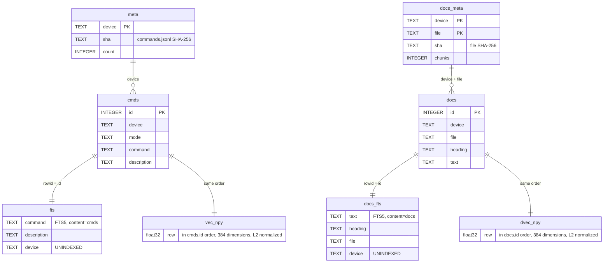
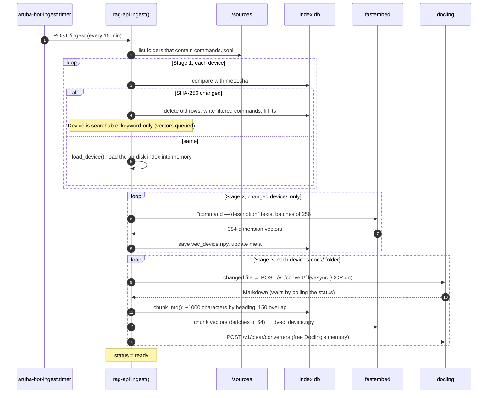
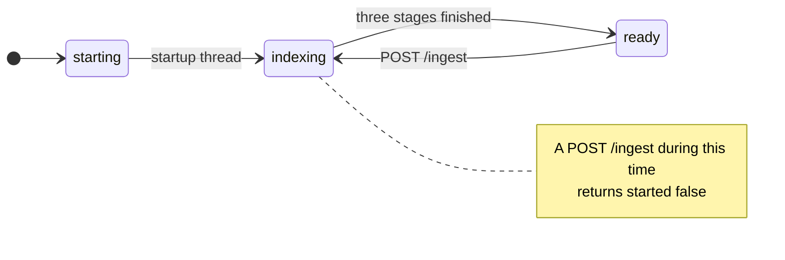
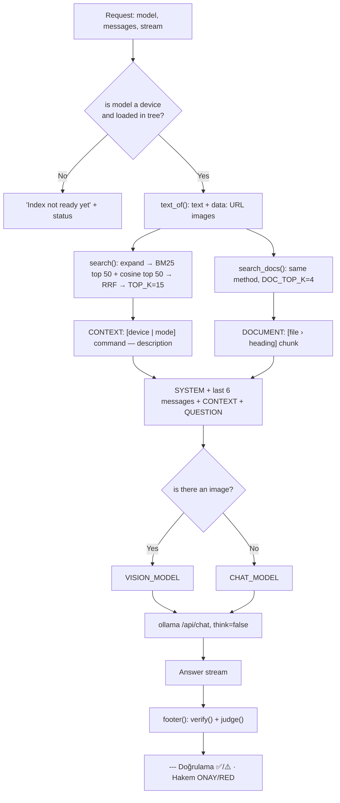
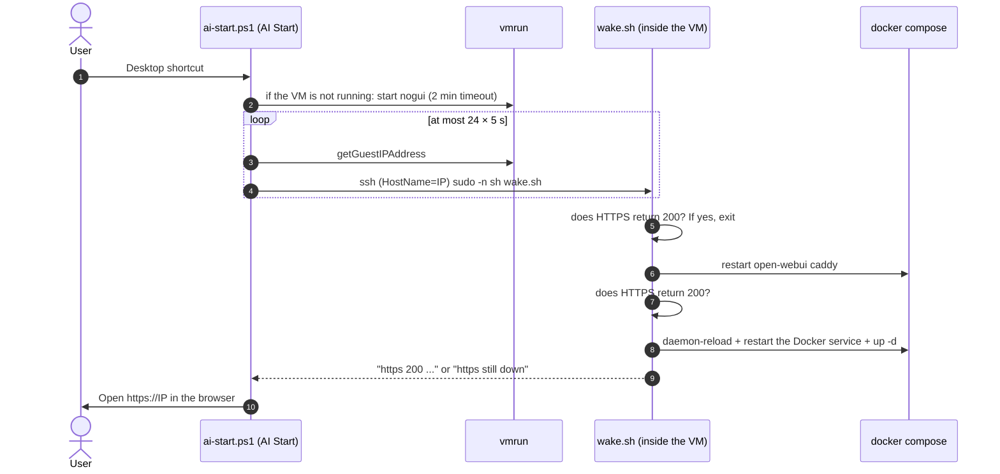

# Architecture

[English](architecture.md) · [Türkçe](tr/architecture.md)

This document is the technical detail behind the summary in the [README](../README.md#-architecture). For installation steps and the reasons for every setting see [USAGE.md](USAGE.md). Source code: [`server/rag-api/app.py`](../server/rag-api/app.py).

- [Deployment topology](#deployment-topology)
- [Data model](#data-model)
- [Indexing](#indexing)
- [Chat request](#chat-request)
- [Verification algorithm](#verification-algorithm)
- [Operations: boot, wake-up, memory](#operations-boot-wake-up-memory)
- [Crawler](#crawler)

---

## Deployment topology

All services run in a single Compose project under `/opt/aruba-bot` on the server ([`compose.yaml`](../server/compose.yaml)).

| Service | Image | Internal address | Published port | Volume | Resource limit |
|---|---|---|---|---|---|
| `caddy` | `caddy:2` | — | **80, 443** | `caddy` (certificates) | — |
| `open-webui` | local build (based on `ghcr.io/open-webui/open-webui:main`) | `open-webui:8080` | — | `webui` | — |
| `rag-api` | local build (`python:3.12-slim`) | `rag-api:8000` | — | `ragdata`, `./sources:ro` | 4 CPU |
| `ollama` | `ollama/ollama:latest` | `ollama:11434` | — | `ollama` (models) | 10 CPU, 10 GB |
| `docling` | `quay.io/docling-project/docling-serve-cpu:latest` | `docling:5001` | — | — | 4 CPU |

The services reach each other over the Compose network by service name. Caddy is on the same network and proxies to `open-webui:8080`. `127.0.0.1:8080` must not be used: Caddy runs in its own container, so that address points to Caddy itself and causes a 502 error ([Troubleshooting](troubleshooting.md)).

---

## Data model

All of rag-api's state lives in the `ragdata` volume (`/data`): a single SQLite file (`index.db`) and per-device NumPy vector matrices. The FTS5 tables are in *external content* mode: the text is in the main table and FTS holds only the index.



| File | Content |
|---|---|
| `/data/index.db` | The six tables above |
| `/data/vec_<device>.npy` | Command vectors; text: `"<command> — <description>"` |
| `/data/dvec_<device>.npy` | Document chunk vectors; text: `"<heading>\n<chunk>"` |
| `/data/models/` | fastembed model cache (downloaded on first start) |

Per device, memory holds: `vecs`/`ids` (vector matrix and row ids), `tree` (for verification, `(first word, word count) → command list`), `roots` (known command roots) and `dvecs`/`dids` (document vectors).

**Source format** (`sources/<device>/commands.jsonl`, one JSON per line):

```json
{"device": "aruba-cx-6200m", "mode": "config", "command": "aaa authentication port-access dot1x authenticator", "description": "Configure 802.1X authenticator"}
```

The device name comes not from the `device` field in the JSON but from the **folder name**. This name appears as the model name in Open WebUI.

---

## Indexing

`ingest()` is triggered in two ways: by a background thread when rag-api starts, or by a `POST /ingest` request. `aruba-bot-ingest.timer` sends the latter every 15 minutes. A trigger that arrives while the service is in the `starting` or `indexing` state is rejected.



**Filter:** lines ending in ` <cr>`, ` |`, ` >`, ` >>` (Enter and output-redirect repeats) and duplicate commands are dropped. That is why the counts in the index are lower than the raw line counts: VMC keeps 57,741 commands out of 73,039 lines, 6200M keeps 102,032 out of 160,201.

**Why two stages:** in the single-stage design, one device could not be used until another device's vectors were finished (6200M ~1.5 h). Now every device becomes searchable by keyword within minutes.

**Service state:**



If a document conversion fails, the error is written to the `errors` field of the `/health` output under the `device/file` key. The other files keep being processed.

---

## Chat request

`POST /v1/chat/completions` (OpenAI-compatible, supports `stream`):



(In the code the labels are Turkish: `BAĞLAM` = context, `DÖKÜMAN` = document, `SORU` = question.)

- **Query expansion (`SYNONYMS`):** CLI terms are added to what the user wrote. Examples: `802.1x` → `dot1x port-access authenticator`, `ge 1 1 1` → `interface 1/1/1`, `lacp` → `lag lacp`.
- **Stop words (`STOP`):** words such as `bana`, `için`, `yaz`, `nasıl`, `komut` and bare numbers are removed from the search.
- **Reciprocal Rank Fusion:** a result's score across both lists is `Σ 1 / (60 + rank)`. There is no need to normalize BM25 and cosine scores.
- **If the vectors are not ready:** only BM25 is used, and a note "Vektör indeksi hazırlanıyor" (vector index being prepared) is added to the start of the answer.
- **`think: false`:** qwen3's thinking output is off. On CPU it roughly doubled the answer time.

---

## Verification algorithm

`verify(devs, answer)` is deterministic and uses no LLM:

1. Collects the lines of code blocks in the answer (except those starting with `!` and `#`) and single-line `backticked` expressions.
2. Strips a command prompt at the start of a line (such as `switch#`, `switch(config)#`, a prefix without spaces).
3. Considers only expressions that start with a lowercase letter and whose first word is a known command root (`roots`) of the device. This way file and parameter names are not mistaken for "commands".
4. Looks in the command tree for a record with the same first word and the same word count. Each word must either match exactly or its counterpart in the tree must be a placeholder: containing `<...>`, `[...]`, UPPERCASE or `A.B.C.D`.
5. Splits the results into `ok` / `bad`. Footer: `✅ N komut dizinde var · ⚠️ dizinde yok: ...` (N commands exist in the index · not in the index: ...)

`judge()` runs if `JUDGE_MODEL` is set and the context is not empty. It gives the context and the answer to the small model and appends the first line (`ONAY: ...` / `RED: ...`) to the footer.

---

## Operations: boot, wake-up, memory

The server runs as a VMware Workstation VM on a laptop. The VM is suspended and resumed by hand with the scripts in `vm-control/` on the Windows side.



The third rung of the repair ladder came from a failure: after a resume and after one boot, Docker's internal network did not forward data. The TCP connection was made but the TLS handshake got no answer. Restarting the containers was not enough; restarting the Docker service fixed it ([USAGE.md §23.4](USAGE.md#234-server-side-files)).

**Memory layers** (VMware does not give back to Windows the memory the VM used once):

| Layer | Mechanism | Where |
|---|---|---|
| Model unloading | `OLLAMA_KEEP_ALIVE: 5m` | `compose.yaml` |
| Cache dropping | When idle (no model, no indexing) `drop_caches` | `idle.sh` + `aruba-bot-idle.timer` (5 min) |
| VM memory | 24 GB → 14 GB | VMware `.vmx` → `memsize` |
| VM sleep | By hand, "AI Uyut" (AI Sleep, `vmrun suspend`) | `vm-control/ai-sleep.ps1` |

---

## Crawler

[`crawler/<device>/aruba_crawl.py`](../crawler/aruba-vmc/aruba_crawl.py) connects to the device over SSH (paramiko) and walks the CLI help (`?`) depth-first. It runs no command. It presses Enter only to turn paging off, for `enable`, `configure terminal` and `exit`. It writes every finding immediately to the file `aruba_cli_tree_<root>.md`. Progress is kept in `state_<root>.json`; if the crawl is interrupted it resumes where it stopped.

| Parameter | Default | Description |
|---|---|---|
| `--host` | device IP | Target device |
| `--depth` | `8` | Maximum word depth |
| `--modes` | VMC: `enable,config` · 6200M: `exec,config` | Modes to crawl |
| `--root` | empty (whole tree) | `mode:command`, e.g. `enable:show` |
| `--skip` | empty | Do not descend into a branch that starts with this prefix |
| `--wait` | `0.5` | Delay between queries (s) |

Credentials are read from the environment variables `ARUBA_USER` / `ARUBA_PASS` / `ARUBA_ENABLE` or asked for in the terminal. `run_crawl.ps1` asks for the password once and does not write it to disk; if the crawl crashes it restarts it after 30 s.

**Permutation pruning:** because filter options (as in `show ap database ...`) can be typed in any order one after another, the tree exploded. If the same last word and the same set of sub-options have been seen before, that branch is not entered. Details: [Troubleshooting](troubleshooting.md#crawler-lessons-cli-tree-crawling).

The `commands.jsonl` files are produced from these `.md` trees as one JSON per line. The conversion is done with [`crawler/tree_to_jsonl.py`](../crawler/tree_to_jsonl.py).
