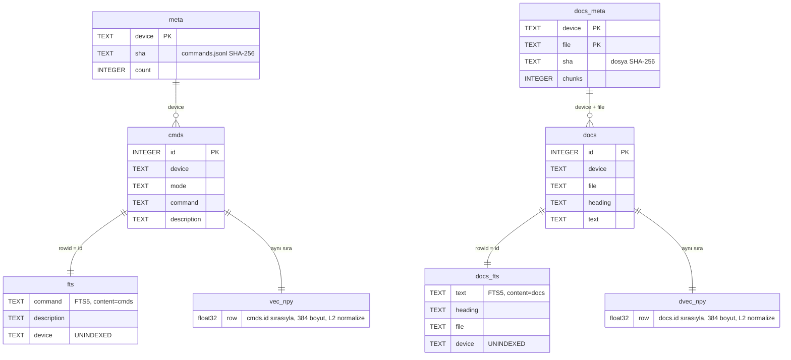
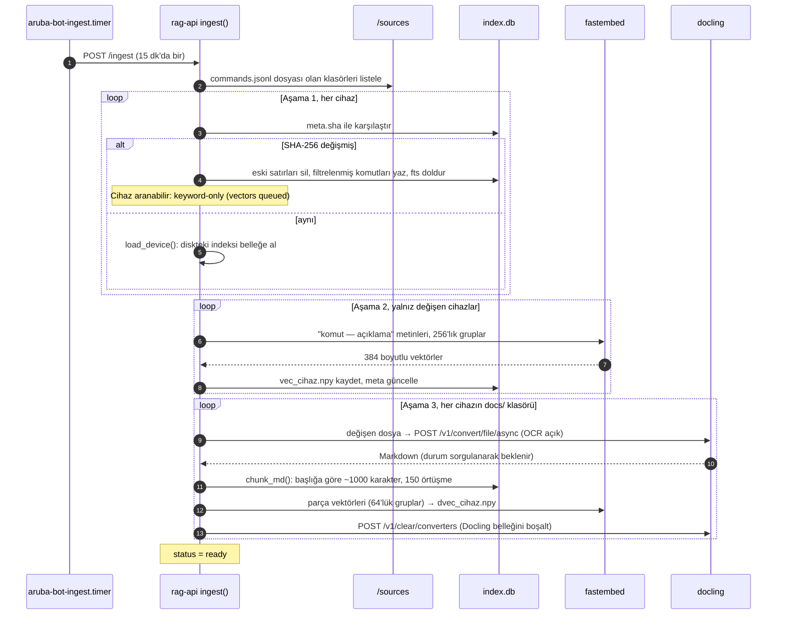
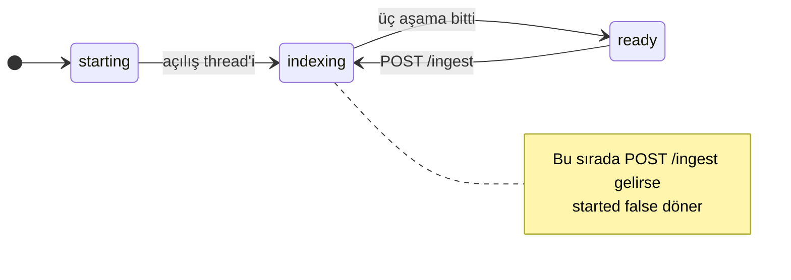
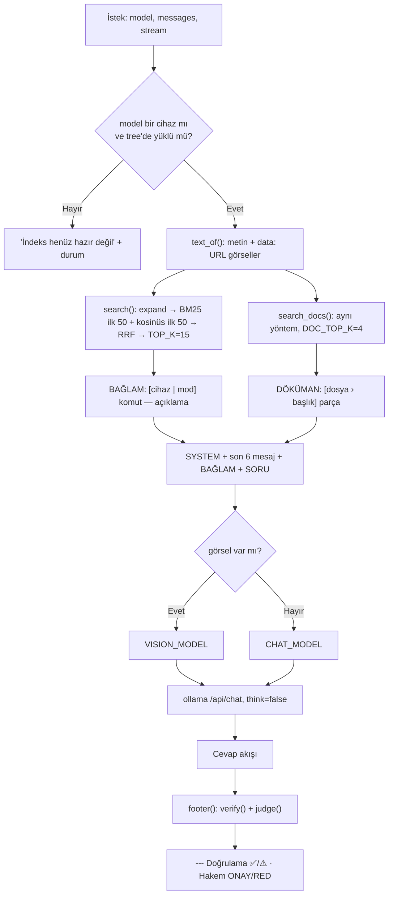
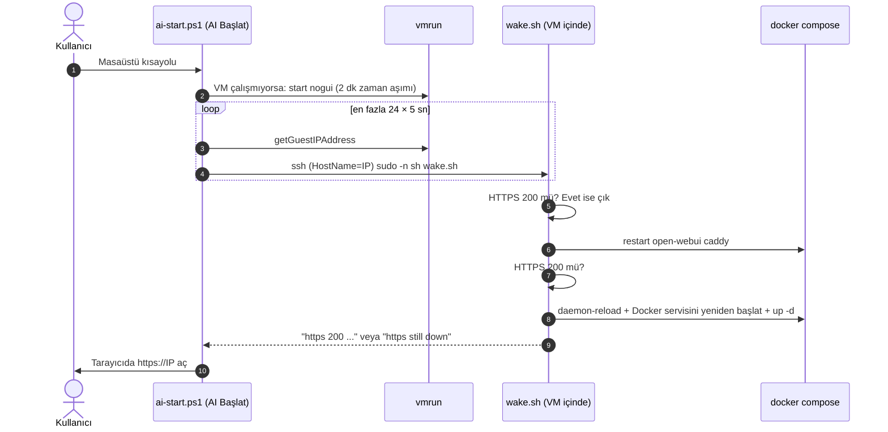

# Mimari

[English](../architecture.md) · [Türkçe](architecture.md)

Bu belge [README](../../README.tr.md#-mimari)'deki özetin teknik ayrıntısıdır. Kurulum adımları ve ayarların gerekçeleri için [KULLANIM.md](KULLANIM.md). Kaynak kod: [`server/rag-api/app.py`](../../server/rag-api/app.py).

- [Dağıtım topolojisi](#dağıtım-topolojisi)
- [Veri modeli](#veri-modeli)
- [İndeksleme](#indeksleme)
- [Sohbet isteği](#sohbet-isteği)
- [Doğrulama algoritması](#doğrulama-algoritması)
- [Operasyon: açılış, uyanma, bellek](#operasyon-açılış-uyanma-bellek)
- [Crawler](#crawler)

---

## Dağıtım topolojisi

Tüm servisler tek bir Compose projesinde, sunucuda `/opt/aruba-bot` altında çalışır ([`compose.yaml`](../../server/compose.yaml)).

| Servis | İmaj | İç adres | Yayınlanan port | Volume | Kaynak sınırı |
|---|---|---|---|---|---|
| `caddy` | `caddy:2` | — | **80, 443** | `caddy` (sertifikalar) | — |
| `open-webui` | lokal build (`ghcr.io/open-webui/open-webui:main` tabanlı) | `open-webui:8080` | — | `webui` | — |
| `rag-api` | lokal build (`python:3.12-slim`) | `rag-api:8000` | — | `ragdata`, `./sources:ro` | 4 CPU |
| `ollama` | `ollama/ollama:latest` | `ollama:11434` | — | `ollama` (modeller) | 10 CPU, 10 GB |
| `docling` | `quay.io/docling-project/docling-serve-cpu:latest` | `docling:5001` | — | — | 4 CPU |

Servisler birbirine Compose ağı üzerinden servis adıyla erişir. Caddy de bu ağdadır ve `open-webui:8080`'e proxy yapar. `127.0.0.1:8080` kullanılmamalıdır: Caddy kendi konteynerinde çalıştığı için bu adres Caddy'nin kendisini gösterir ve 502 hatasına yol açar ([Sorunlar ve Çözümler](sorunlar-ve-cozumler.md)).

---

## Veri modeli

rag-api'nin tüm durumu `ragdata` volume'ünde (`/data`) tutulur: tek bir SQLite dosyası (`index.db`) ve cihaz başına NumPy vektör matrisleri. FTS5 tabloları *external content* modundadır: metin ana tablodadır, FTS yalnız indeksi tutar.



| Dosya | İçerik |
|---|---|
| `/data/index.db` | Yukarıdaki altı tablo |
| `/data/vec_<cihaz>.npy` | Komut vektörleri; metin: `"<komut> — <açıklama>"` |
| `/data/dvec_<cihaz>.npy` | Döküman parçası vektörleri; metin: `"<başlık>\n<parça>"` |
| `/data/models/` | fastembed model önbelleği (ilk açılışta indirilir) |

Bellekte cihaz başına şunlar tutulur: `vecs`/`ids` (vektör matrisi ve satır id'leri), `tree` (doğrulama için `(ilk kelime, kelime sayısı) → komut listesi`), `roots` (bilinen komut kökleri), `dvecs`/`dids` (döküman vektörleri).

**Kaynak biçimi** (`sources/<cihaz>/commands.jsonl`, satır başına bir JSON):

```json
{"device": "aruba-cx-6200m", "mode": "config", "command": "aaa authentication port-access dot1x authenticator", "description": "Configure 802.1X authenticator"}
```

Cihaz adı JSON'daki `device` alanından değil, **klasör adından** gelir. Bu ad Open WebUI'da model adı olarak görünür.

---

## İndeksleme

`ingest()` iki yoldan tetiklenir: rag-api açılırken bir arka plan thread'iyle, ya da `POST /ingest` isteğiyle. İkincisini `aruba-bot-ingest.timer` 15 dakikada bir gönderir. Servis `starting` veya `indexing` durumundayken gelen tetikleme reddedilir.



**Filtre:** ` <cr>`, ` |`, ` >`, ` >>` ile biten satırlar (Enter ve çıktı yönlendirme tekrarları) ile tekrar eden komutlar elenir. Bu yüzden indeksteki sayılar ham satır sayısından azdır: VMC 73.039 satırdan 57.741 komut, 6200M 160.201 satırdan 102.032 komut kalır.

**Neden iki aşama:** Tek aşamalı tasarımda bir cihazın vektörleri bitmeden (6200M ~1,5 saat) diğer cihaz hiç kullanılamıyordu. Şimdi bütün cihazlar dakikalar içinde anahtar kelimeyle aranabilir hale gelir.

**Servis durumu:**



Döküman dönüştürmede hata olursa `/health` çıktısındaki `errors` alanına `cihaz/dosya` anahtarıyla yazılır. Diğer dosyaların işlenmesi devam eder.

---

## Sohbet isteği

`POST /v1/chat/completions` (OpenAI uyumlu, `stream` destekli):



- **Sorgu genişletme (`SYNONYMS`):** kullanıcının yazdığı ifadeye CLI terimleri eklenir. Örnekler: `802.1x` → `dot1x port-access authenticator`, `ge 1 1 1` → `interface 1/1/1`, `lacp` → `lag lacp`.
- **Durak kelimeler (`STOP`):** `bana`, `için`, `yaz`, `nasıl`, `komut` gibi kelimeler ve tek başına sayılar aramadan çıkarılır.
- **Reciprocal Rank Fusion:** her iki listede bir sonucun puanı `Σ 1 / (60 + sıra)` olarak hesaplanır. BM25 ile kosinüs skorlarını normalize etmeye gerek kalmaz.
- **Vektörler hazır değilse:** yalnız BM25 kullanılır ve cevabın başına "Vektör indeksi hazırlanıyor" notu eklenir.
- **`think: false`:** qwen3'ün düşünme çıktısı kapalıdır. CPU'da cevap süresini yaklaşık ikiye katlıyordu.

---

## Doğrulama algoritması

`verify(devs, answer)` deterministiktir ve LLM kullanmaz:

1. Cevaptaki kod bloklarının satırlarını (`!` ve `#` ile başlayanlar hariç) ve tek satırlık `ters tırnaklı` ifadeleri toplar.
2. Satır başındaki komut istemini (`switch#`, `switch(config)#` gibi, boşluksuz önek) atar.
3. Yalnız küçük harfle başlayan ve ilk kelimesi cihazın bilinen bir komut kökü (`roots`) olan ifadeleri değerlendirir. Böylece dosya ve parametre adları yanlışlıkla "komut" sayılmaz.
4. Komut ağacında aynı ilk kelimeye ve aynı kelime sayısına sahip bir kayıt arar. Her kelime ya birebir eşleşmeli ya da ağaçtaki karşılığı bir yer tutucu olmalıdır: `<...>`, `[...]`, BÜYÜK HARF veya `A.B.C.D` içeren.
5. Sonuçları `ok` / `bad` olarak ayırır. Dipnot: `✅ N komut dizinde var · ⚠️ dizinde yok: ...`

`judge()`, `JUDGE_MODEL` tanımlıysa ve bağlam boş değilse çalışır. Bağlamı ve cevabı küçük modele verir, ilk satırı (`ONAY: ...` / `RED: ...`) dipnota ekler.

---

## Operasyon: açılış, uyanma, bellek

Sunucu, bir dizüstü bilgisayarda VMware Workstation VM'i olarak çalışır. VM, Windows tarafındaki `vm-control/` script'leriyle elle uyutulur ve uyandırılır.



Onarım merdiveninin üçüncü basamağı bir arızadan doğdu: uyanma ve bir açılış sonrasında Docker iç ağı veri iletmedi. TCP bağlantısı kuruluyor, TLS el sıkışması cevapsız kalıyordu. Konteynerleri yeniden başlatmak yetmedi, Docker servisini yeniden başlatmak düzeltti ([KULLANIM.md §23.4](KULLANIM.md#234-sunucu-tarafı-dosyaları)).

**Bellek katmanları** (VMware, VM'in bir kez kullandığı belleği Windows'a geri vermiyor):

| Katman | Mekanizma | Nerede |
|---|---|---|
| Model boşaltma | `OLLAMA_KEEP_ALIVE: 5m` | `compose.yaml` |
| Önbellek bırakma | Boştayken (model yok, indeksleme yok) `drop_caches` | `idle.sh` + `aruba-bot-idle.timer` (5 dk) |
| VM belleği | 24 GB → 14 GB | VMware `.vmx` → `memsize` |
| VM uykusu | Elle, "AI Uyut" (`vmrun suspend`) | `vm-control/ai-sleep.ps1` |

---

## Crawler

[`crawler/<cihaz>/aruba_crawl.py`](../../crawler/aruba-vmc/aruba_crawl.py), cihaza SSH (paramiko) ile bağlanır ve CLI yardımını (`?`) DFS ile gezer. Hiçbir komutu çalıştırmaz. Enter tuşuna yalnızca sayfalamayı kapatmak, `enable`, `configure terminal` ve `exit` için basar. Her bulguyu anında `aruba_cli_tree_<kök>.md` dosyasına yazar. İlerleme `state_<kök>.json` dosyasında tutulur; tarama kesilirse kaldığı yerden devam eder.

| Parametre | Varsayılan | Açıklama |
|---|---|---|
| `--host` | cihaz IP'si | Hedef cihaz |
| `--depth` | `8` | En fazla kelime derinliği |
| `--modes` | VMC: `enable,config` · 6200M: `exec,config` | Taranacak modlar |
| `--root` | boş (tüm ağaç) | `mod:komut`, ör. `enable:show` |
| `--skip` | boş | Bu önekle başlayan dala inme |
| `--wait` | `0.5` | Sorgular arası bekleme (sn) |

Kimlik bilgileri `ARUBA_USER` / `ARUBA_PASS` / `ARUBA_ENABLE` ortam değişkenlerinden okunur ya da terminalde sorulur. `run_crawl.ps1` şifreyi bir kez sorar, diske yazmaz; tarama çökerse 30 sn sonra yeniden başlatır.

**Permütasyon budaması:** Filtre seçenekleri (`show ap database ...` gibi) her sırayla art arda yazılabildiği için ağaç patlıyordu. Aynı son kelime ve aynı alt seçenek kümesi daha önce görüldüyse o dala inilmez. Ayrıntı: [Sorunlar ve Çözümler](sorunlar-ve-cozumler.md#crawler-cli-ağacı-tarama-dersleri).

`commands.jsonl` dosyaları bu `.md` ağaçlarından satır başına bir JSON olacak şekilde üretilmiştir. Dönüştürme [`crawler/tree_to_jsonl.py`](../../crawler/tree_to_jsonl.py) ile yapılır.
